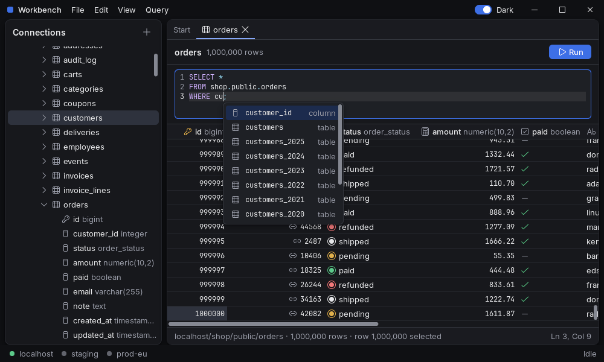
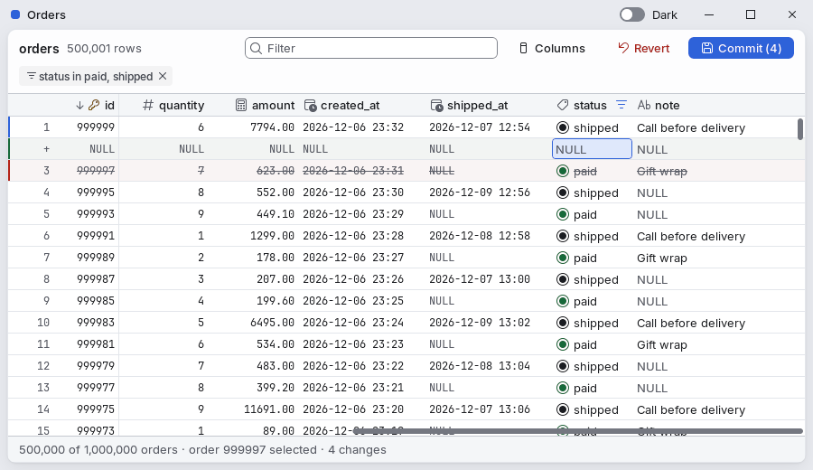
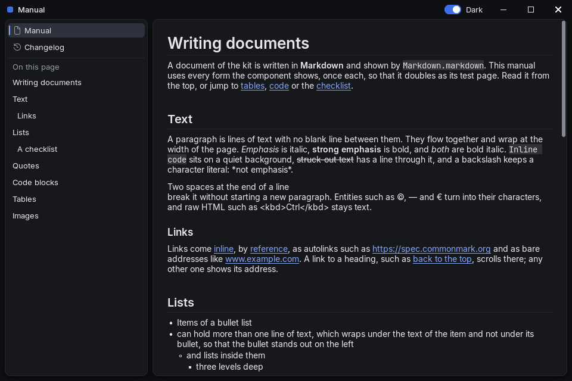

<p align="center">
  
</p>

# rethinkj UI

A native, GPU-rendered UI framework for Java. It draws everything itself (text, layout, animation, controls) with wgpu in SDL windows, and it can run without a window: a script drives the app, and images and element trees come out, so that an agent or a test can see and use what it builds.

It is modelled on [rune](https://github.com/anomalyco/rune), which does the same for Rust.



## Status

Early. The version is `0.1.0-SNAPSHOT`, nothing is published to Maven Central yet, and the API still changes. It targets desktops only: Windows 11 and Linux on x64, with JDK 25.

## What is in it

- **`core`**: an element tree with flexbox layout, text shaped with HarfBuzz and rasterised with FreeType, springs, shadows, clipping, scrolling, lists that build only the rows in view, overlays, focus, pointer and keyboard input, text fields and multi-line editors for texts of 100 000 lines, images, several windows with drags between them, work off the app's thread, and a GPU renderer that is checked pixel by pixel against a CPU reference.
- **`kit`**: a theme and components built on `core`: buttons, fields, selects and combo boxes, menus and a menu bar, dialogs, a data grid for a million rows with editing, filters and frozen columns, a tree, tabs that tear off into windows, split panes, a code editor with highlighting, completion and find, a command palette, Markdown, progress, status bar, toolbar and more, in a dark and a light theme.
- **`examples`**: runnable apps written the way a user of the library writes them.

`core` and `kit` depend on `java.base` only: no AWT, no reflection, native code through the Foreign Function & Memory API.

| | |
| --- | --- |
|  |  |

## A first app

An app is a state object and a function from that state to a tree of elements. Handlers change the state; the view is built again after each input.

```java
public final class Lights {

  boolean on; // the state: plain fields, changed only by handlers

  public static void main(String[] args) throws Exception {
    App<Lights> app = new App<>(new Lights(), Lights::view);
    if (Script.handle(args, app)) {
      return; // --script <file> --out <folder>: no window, images and trees instead
    }
    try (Window window = Window.open("Lights", 360, 240, Window.options());
        GpuPresenter presenter = new GpuPresenter(window)) {
      WindowLoop.run(window, app, presenter);
    }
  }

  // The view: a function from the state to a tree of elements, built again after each input.
  static El view(Lights s) {
    Theme t = Theme.DARK;
    El lamp = el().key("lamp").size(56, 56).radius(28)
        .fill(s.on ? 0xFFFACC15 : t.surface().raised())
        .motion(t.motion().move()); // the colour springs to its new value
    return col().wFull().hFull().fill(t.surface().window()).center()
        .child(Card.card(t, lamp, toggle(t, s.on, "Lamp", () -> s.on = !s.on))
            .padding(t.space().xxl()).gap(t.space().xl()).align(Style.Align.CENTER));
  }
}
```

## Driving an app without a window

The same app runs under a script. Each step is one line; `snap` writes a PNG and the element tree as text:

```text
size 360 240 scale 2
frame
press role=switch label="Lamp"
frame
advance 1
frame
snap on
```

```text
el 0,0 360x240
  el 120,51 120x138
    el #lamp 152,76 56x56
    el role=switch label="Lamp" 141,146 78x20 checked
      el 145,148 28x16
        el 159,150 12x12
      text "Lamp" 181,148 34x16
```

Targets are selectors over roles, labels and states, so a script reads like what a person does. The tree says what an agent would otherwise have to read from pixels: what is checked, selected, focused, disabled or busy. The project's own tests are written this way, and its stored images are the snaps of such scripts.

## Building and running the examples

Requires JDK 25 and Maven 3.9 or later. The first build downloads the native libraries and builds some of them from source, which needs a C toolchain; [AGENTS.md](AGENTS.md#build) lists what each platform needs.

```sh
mvn verify                                   # build and test everything
mvn -q -pl examples -am compile exec:exec    # the light switch
mvn -q -pl examples -am compile exec:exec -Dexample=Workbench
```

Other examples: `Showcase` (every component of the kit), `DataBrowser` (a million rows, editable), `Documents` (tabs that tear off, file dialogs), `Manual` (Markdown), `Settings`, `ConnectionDialog`, `Notes`.

## Using it in a project

Until there is a release, build it locally and depend on the snapshot. The artifacts share the group `com.rethinkj.ui`:

| Artifact | What it is |
| --- | --- |
| `rethinkj-ui-core` | The framework |
| `rethinkj-ui-kit` | Theme and components |
| `rethinkj-ui-fonts` | Inter and JetBrains Mono, the default fonts |
| `rethinkj-ui-icons` | Fluent UI System Icons, the default icon font |
| `rethinkj-ui-natives-windows-x64`, `rethinkj-ui-natives-linux-x64` | SDL3, wgpu-native, FreeType and HarfBuzz for a platform |

Run with `--enable-native-access=ALL-UNNAMED` (or `=com.rethinkj.ui` on the module path).

## Documentation

**[ui.rethinkj.com](https://ui.rethinkj.com)** is the documentation for users of the library: getting started, concepts, a page per component, and how to drive an app without a window. Every page is also Markdown for agents: [llms.txt](https://ui.rethinkj.com/llms.txt) lists them, and [llms-full.txt](https://ui.rethinkj.com/llms-full.txt) holds them all. Its source is in [`docs/`](docs).

[AGENTS.md](AGENTS.md) is the reference for working on the framework itself: every script step, the element API by topic, each component of the kit, the renderers, windows and native libraries. It is written for agents and for people alike. Changes since the last release are under [`changelog/unreleased`](changelog/unreleased).

## License

MIT, see [LICENSE](LICENSE). The fonts, the icon font and the native libraries come under their own licences, which their modules include.
