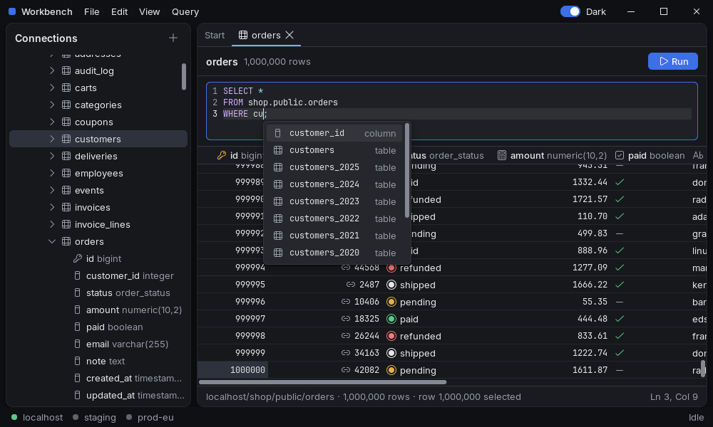
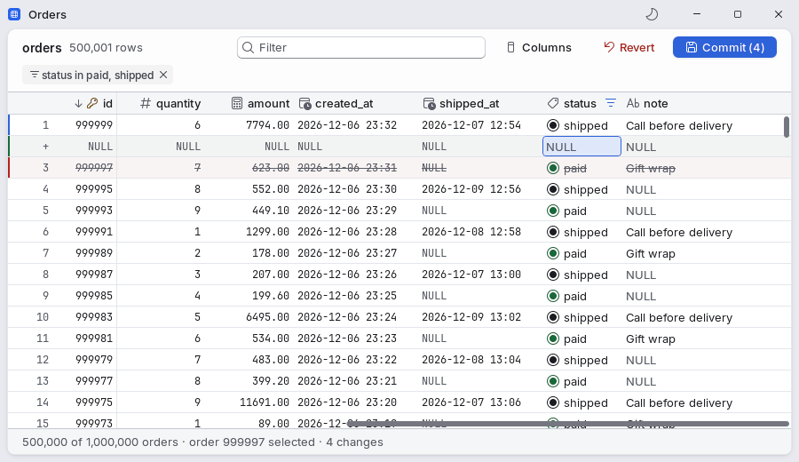
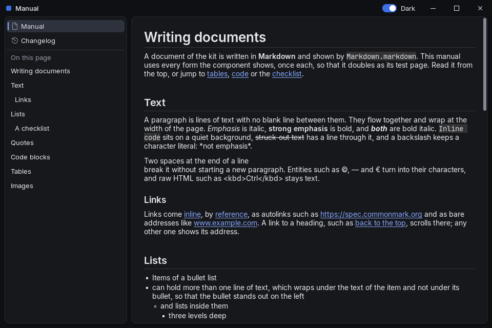

<p align="center">
  
</p>

# rethinkj UI

A native, GPU-rendered desktop UI framework for Java 25. It renders everything itself (text, layout, animations, and controls) using wgpu in SDL windows, and can also run headless without a window so automated tests and AI agents can drive your app with scripts and inspect screenshots and element trees.

Inspired by [rune](https://github.com/anomalyco/rune) for Rust.



## Status

Early preview (`0.1.0-SNAPSHOT` on Maven Central Snapshots). The API may still change before the first stable release. Targets desktop platforms: **Windows 11+** and **Linux** (x64) with **JDK 25**.

## What is included

- **`core`**: Element tree with flexbox layout, HarfBuzz text shaping and FreeType rendering, spring animations, shadows, clipping, scrolling, virtual lists, overlays, focus, mouse and keyboard input, text fields and code editors (100,000+ lines), images, multi-window drag and drop, background tasks, and GPU/CPU rendering.
- **`kit`**: Dark and light themes plus ready-made components: buttons, text/number fields, selects, combo boxes, menus, menu bar, dialogs, a data grid for a million rows (with editing, filters, and frozen columns), lazy-loading tree, tear-off tabs, split panes, code editor (syntax highlighting, completion, find), command palette, Markdown viewer, progress indicators, status bar, toolbar, and more.
- **`examples`**: Complete runnable demo apps.

`core` and `kit` depend only on `java.base` — no AWT, no Swing, and no reflection. Native libraries are called through Java's Foreign Function & Memory API.

| | |
| --- | --- |
|  |  |

## Quick example

An app is a plain state object and a view function that returns a tree of elements. Event handlers update the state, and rethinkj UI rebuilds the view automatically.

```java
public final class Lights {

  boolean on; // plain Java state, updated only by event handlers

  public static void main(String[] args) throws Exception {
    App<Lights> app = new App<>(new Lights(), Lights::view);
    if (Script.handle(args, app)) {
      return; // --script <file> --out <folder>: run headless and save screenshots + trees
    }
    try (Window window = Window.open("Lights", 360, 240, Window.options());
        GpuPresenter presenter = new GpuPresenter(window)) {
      WindowLoop.run(window, app, presenter);
    }
  }

  // Rebuilt automatically after each input event.
  static El view(Lights state) {
    Theme theme = Theme.CURRENT.get(); // dark theme by default
    El lamp = el().key("lamp")
        .size(56, 56)
        .radius(28)
        .fill(state.on ? Colors.rgb(0xFACC15) : theme.surface().raised())
        .motion(theme.motion().move()); // smoothly animate color changes
    return col()
        .wFull()
        .hFull()
        .fill(theme.surface().window())
        .center()
        .child(Card.card(lamp, toggle(state.on, "Lamp", state::toggleLamp))
            .padding(theme.space().xxl())
            .gap(theme.space().xl())
            .align(Style.Align.CENTER));
  }

  void toggleLamp() {
    on = !on;
  }
}
```

## Headless scripting and testing

Run the same app without a window using a script. Each line is one step, and `snap` writes a PNG screenshot and an element tree:

```text
size 360 240 scale 2
frame
press role=switch label="Lamp"
frame
advance 1
frame
snap on
```

```text
el 0,0 360x240
  el 120,51 120x138
    el #lamp 152,76 56x56
    el role=switch label="Lamp" 141,146 78x20 checked
      el 145,148 28x16
        el 159,150 12x12
      text "Lamp" 181,148 34x16
```

Scripts target elements by role, label, and state. The tree dump exposes states like `checked`, `selected`, `focused`, `disabled`, and `busy` as plain text so tests and AI agents can verify UI behavior reliably.

## Using it in your project

Add the Maven Central Snapshots repository and dependencies under group `com.rethinkj.ui`:

| Artifact | Purpose |
| --- | --- |
| `rethinkj-ui-core` | Core framework |
| `rethinkj-ui-kit` | Themes and components (includes `core`) |
| `rethinkj-ui-fonts` | Default fonts (Inter and JetBrains Mono) |
| `rethinkj-ui-icons` | Default icon font (Fluent UI System Icons) |
| `rethinkj-ui-natives-windows-x64`, `rethinkj-ui-natives-linux-x64` | Platform native libraries (SDL3, wgpu-native, FreeType, HarfBuzz, plus DXC on Windows) |

```xml
<properties>
  <rethinkj.ui.version>0.1.0-SNAPSHOT</rethinkj.ui.version>
</properties>

<repositories>
  <repository>
    <id>central-snapshots</id>
    <url>https://central.sonatype.com/repository/maven-snapshots/</url>
    <releases><enabled>false</enabled></releases>
    <snapshots><enabled>true</enabled></snapshots>
  </repository>
</repositories>

<dependencies>
  <dependency>
    <groupId>com.rethinkj.ui</groupId>
    <artifactId>rethinkj-ui-kit</artifactId>
    <version>${rethinkj.ui.version}</version>
  </dependency>
  <dependency>
    <groupId>com.rethinkj.ui</groupId>
    <artifactId>rethinkj-ui-fonts</artifactId>
    <version>${rethinkj.ui.version}</version>
    <scope>runtime</scope>
  </dependency>
  <dependency>
    <groupId>com.rethinkj.ui</groupId>
    <artifactId>rethinkj-ui-icons</artifactId>
    <version>${rethinkj.ui.version}</version>
    <scope>runtime</scope>
  </dependency>
</dependencies>

<profiles>
  <profile>
    <id>natives-linux-x64</id>
    <activation>
      <os><name>Linux</name><arch>amd64</arch></os>
    </activation>
    <dependencies>
      <dependency>
        <groupId>com.rethinkj.ui</groupId>
        <artifactId>rethinkj-ui-natives-linux-x64</artifactId>
        <version>${rethinkj.ui.version}</version>
        <scope>runtime</scope>
      </dependency>
    </dependencies>
  </profile>
  <profile>
    <id>natives-windows-x64</id>
    <activation>
      <os><family>windows</family><arch>amd64</arch></os>
    </activation>
    <dependencies>
      <dependency>
        <groupId>com.rethinkj.ui</groupId>
        <artifactId>rethinkj-ui-natives-windows-x64</artifactId>
        <version>${rethinkj.ui.version}</version>
        <scope>runtime</scope>
      </dependency>
    </dependencies>
  </profile>
</profiles>
```

Run your app with `--enable-native-access=ALL-UNNAMED` (or `--enable-native-access=com.rethinkj.ui` on the module path). Linux requires glibc 2.38+ (for example, Ubuntu 24.04+). See [Installation](https://ui.rethinkj.com/docs/get-started) for Gradle setup and a complete project template.

## Building and running the examples

Requires JDK 25, Maven 3.9+, and a C/C++ toolchain on the first build (see [Platforms and native libraries](https://ui.rethinkj.com/docs/reference/platforms#what-a-build-needs)).

```sh
mvn verify                                                     # build and run tests
mvn -q -pl examples -am compile exec:exec                      # run LightSwitch
mvn -q -pl examples -am compile exec:exec -Dexample=Workbench  # run Workbench
```

Other examples: `Showcase`, `DataBrowser`, `Documents`, `Manual`, `Settings`, `ConnectionDialog`, and `Notes`.

## Documentation

Full documentation is at **[ui.rethinkj.com](https://ui.rethinkj.com)** (also available as Markdown for AI agents via [llms.txt](https://ui.rethinkj.com/llms.txt) and [llms-full.txt](https://ui.rethinkj.com/llms-full.txt)).

## License

MIT — see [LICENSE](LICENSE). Bundled fonts, icons, and native libraries include their own licenses in their modules.
