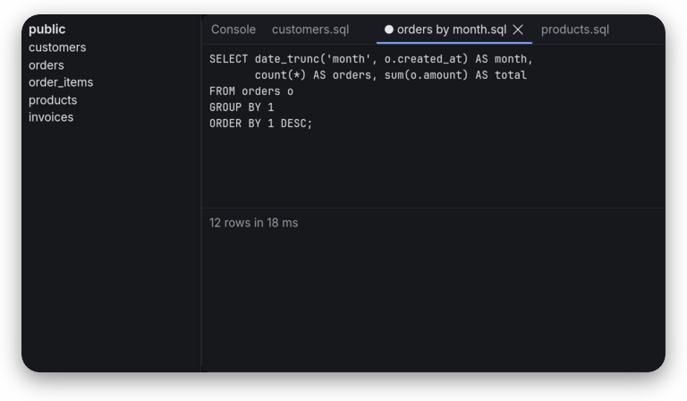

# Writing documents

A document of the kit is written in **Markdown** and shown by `Markdown.markdown`. This manual
uses every form the component shows, once each, so that it doubles as its test page. Read it
from the top, or jump to [tables](#tables), [code](#code-blocks) or the
[checklist](#a-checklist).

## Text

A paragraph is lines of text with no blank line between them. They flow together
and wrap at the width of the page. *Emphasis* is italic, **strong emphasis** is bold, and
***both*** are bold italic. `Inline code` sits on a quiet background, ~~struck-out text~~ has
a line through it, and a backslash keeps a character literal: \*not emphasis\*.

Two spaces at the end of a line  
break it without starting a new paragraph. Entities such as &copy;, &mdash; and &#8364; turn
into their characters, and raw HTML such as <kbd>Ctrl</kbd> stays text.

### Links

Links come [inline](https://commonmark.org "CommonMark"), by [reference][spec], as
autolinks such as <https://spec.commonmark.org> and as bare addresses like
www.example.com. A link to a heading, such as [back to the top](#writing-documents), scrolls
there; any other one shows its address.

[spec]: https://spec.commonmark.org/0.31.2/

## Lists

- Items of a bullet list
- can hold more than one line of text, which wraps under the text of the item and not under
  its bullet, so that the bullet stands out on the left
  - and lists inside them
    - three levels deep

1. Numbered lists count from where they start,
2. and their numbers line up on the right.

A list may start at any number:

9. so this one starts at nine,
10. and its numbers grow wider
11. without moving the text.

A list with blank lines between its items is loose:

- Each item is a paragraph of its own.

- So there is more room between them.

### A checklist

- [x] Read the document
- [x] Select some of its text and copy it
- [ ] Press Control+A, then Control+C, to copy all of it

## Quotes

> A quote has a line along its left edge, and its text is quieter than the text around it.
>
> > Quotes may hold quotes,
>
> and anything else a document holds, such as `code`.

## Code blocks

A fenced code block names its language. SQL is highlighted:

```sql
-- The ten largest orders of this year
SELECT o.id, c.name, o.total
  FROM orders o
  JOIN customers c ON c.id = o.customer_id
 WHERE o.created_at >= DATE '2026-01-01'
 ORDER BY o.total DESC
 LIMIT 10;
```

An indented block is code without a language, and a line longer than the page scrolls
sideways:

    java --enable-native-access=ALL-UNNAMED -cp core/target/classes:fonts/target/classes com.rethinkj.ui.examples.Manual

## Tables

| Form            | Written as        | Shown as        |
| :-------------- | :---------------: | --------------: |
| Emphasis        | `*a*`             | *a*             |
| Strong          | `**a**`           | **a**           |
| Struck out      | `~~a~~`           | ~~a~~           |
| Link            | `[a](#tables)`    | [a](#tables)    |

## Images



---

That is all: a thematic break ends the manual.
